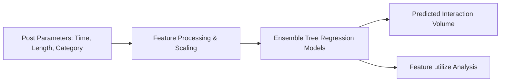

# Social Media Audience Engagement Predictor

> Machine learning regression pipeline forecasting social publication interactions.

[](https://github.com/sohailahmed-bsrh/social-media-engagement-prediction)
[](https://sohail.devsil.com/projects.html)
[](https://sohail.devsil.com)

---

## Overview

Marketing teams publish content with high variability in reach and engagement due to lack of predictive interaction models.

This project provides an end-to-end, reproducible implementation engineered to solve this challenge through verified data transformations, reliable algorithms, and production-ready architecture.

---

## Key Features

- Feature extraction from post metadata including posting hour, content length, and category tags
- Ensemble modeling utilizing Random Forest and Gradient Boosting regressors
- Feature importance analysis quantifying the highest-utilize publishing parameters
- Evaluation via Root Mean Squared Error (RMSE) against holdout benchmarks

---

## System Architecture



---

## Technology Stack

| Technology | Version / Spec | Role in Architecture |
| :--- | :--- | :--- |
| **Python** | `3.10+` | Feature engineering and model training |
| **Scikit-learn** | `1.3+` | Random Forest regressor and GridSearch hyperparameter tuning |
| **Pandas & NumPy** | `2.0+` | Feature matrix manipulation |
| **Matplotlib** | `3.7+` | Feature importance bar plots |

---

## Repository Structure

```text
social-media-engagement-prediction/
|-- dataset/
|   `-- social_media_engagement_prediction.ipynb
|-- notebooks/
|-- data/
|-- .gitignore
|-- requirements.txt
`-- README.md
```

---

## Installation and Execution

### Prerequisites
- Python 3.10 or higher
- Git version control
- Virtual environment manager (`venv`)

### Setup Instructions
1. Clone the repository:
```bash
git clone https://github.com/sohailahmed-bsrh/social-media-engagement-prediction.git
cd social-media-engagement-prediction
```

2. Configure environment and dependencies:
```bash
python -m venv venv
source venv/bin/activate  # On Windows: venv\Scripts\activate
pip install -r requirements.txt
jupyter notebook
```

---

## Interface and Verification
The system produces verifiable execution logs, prediction matrices, or interactive browser interfaces depending on the target mode. Verify operation by executing the commands specified above or inspecting the demonstration notebooks.

---

## Author and Contact
Developed by **Sohail Ahmed** — Full Stack AI Engineer & Machine Learning Specialist.
- **Portfolio:** [sohail.devsil.com](https://sohail.devsil.com)
- **GitHub:** [@sohailahmed-bsrh](https://github.com/sohailahmed-bsrh)
- **Email:** [sohail.bsrh@gmail.com](mailto:sohail.bsrh@gmail.com)
